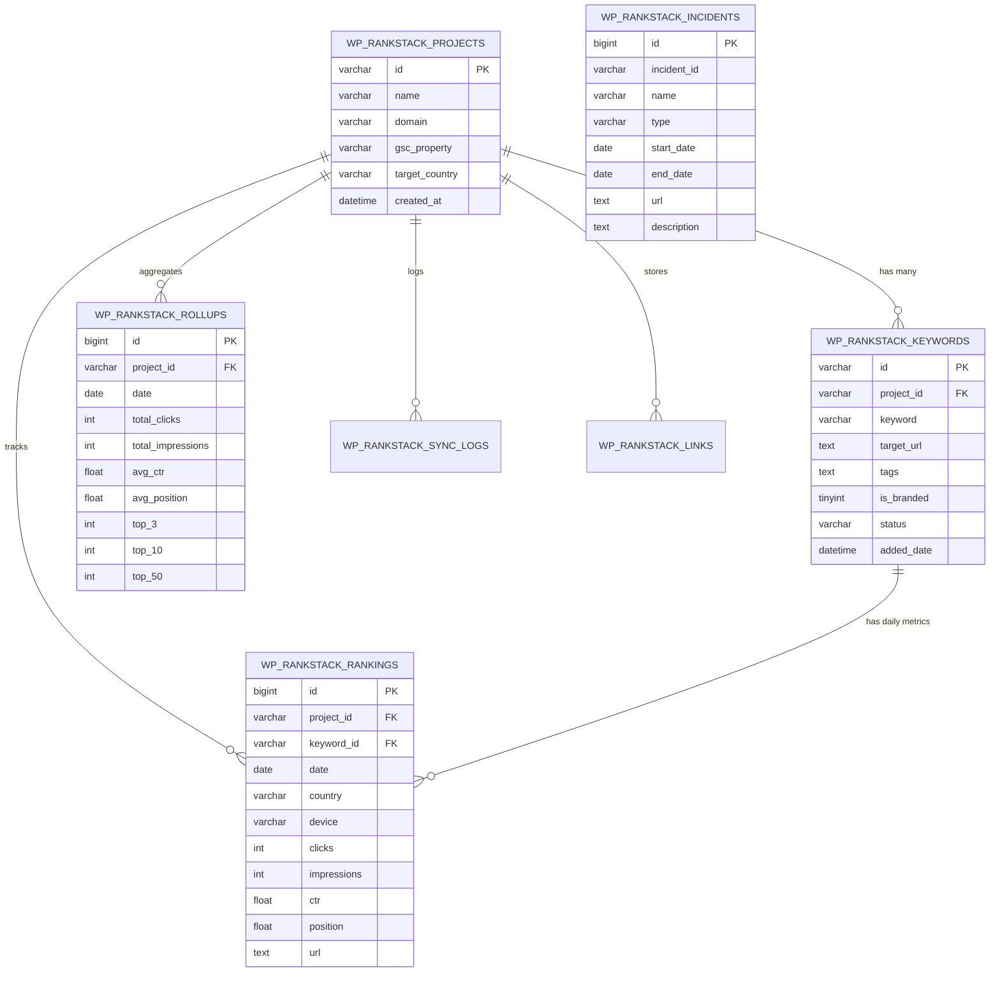
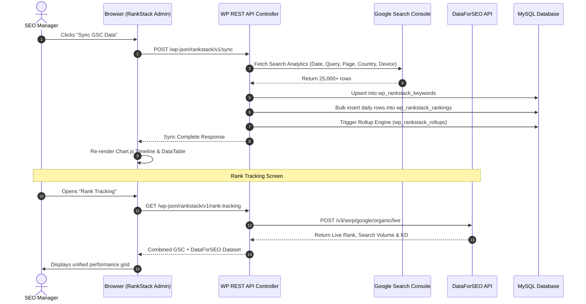

# RankStack — Developer Architecture & Onboarding Guide

Welcome to the **RankStack** development team! This guide is designed to help you quickly understand how RankStack works, how the codebase is structured, how data flows between Google Search Console, DataForSEO, WordPress, and MySQL, and how to effectively use AI tools to build features and fix bugs.

---

## 1. High-Level Architecture Overview

RankStack is an advanced **Search Intelligence & Rank Tracking WordPress Plugin**. It bridges **Google Search Console (GSC)** and **DataForSEO** APIs with WordPress, storing historical SEO metrics in dedicated custom MySQL tables and rendering real-time dashboards, rank tracking tables, and on-page diagnostic diffs.

```mermaid
flowchart TB
    subgraph External_APIs [External Data Sources]
        GSC[Google Search Console API<br/>OAuth2 + SearchAnalytics]
        DFS[DataForSEO API v3<br/>Backlinks Overview + Live SERP]
        GStatus[Google Search Status Feed<br/>incidents.json]
    end

    subgraph WP_Backend [WordPress Plugin Core (PHP)]
        Bootstrap[rank-stack.php<br/>Main Bootstrap]
        Admin[class-rankstack-admin.php<br/>Menus, Screens & Enqueues]
        REST[class-rankstack-rest-api.php<br/>WP REST API Controller]
        GSC_Sync[class-rankstack-gsc.php<br/>OAuth & Fetch Engine]
        DB_Layer[class-rankstack-db.php<br/>Data Access Layer & ORM]
        Rollups[class-rankstack-rollups.php<br/>Aggregation & KPI Engine]
        Crypto[class-rankstack-crypto.php<br/>AES-256 Token Encryption]
    end

    subgraph MySQL_DB [WordPress Custom Database Tables]
        T_Projects[(wp_rankstack_projects)]
        T_Keywords[(wp_rankstack_keywords)]
        T_Rankings[(wp_rankstack_rankings)]
        T_Rollups[(wp_rankstack_rollups)]
        T_SyncLogs[(wp_rankstack_sync_logs)]
        T_Incidents[(wp_rankstack_incidents)]
        T_Links[(wp_rankstack_links)]
    end

    subgraph Frontend_UI [Admin Dashboard & Visualizations (Vanilla JS)]
        DashJS[rankstack-dashboard.js<br/>Chart.js Timeline & KPIs]
        KWJS[rankstack-keywords.js<br/>Keyword Intelligence Grid]
        RankJS[rankstack-rank-tracking.js<br/>DataForSEO + GSC Tracker]
        DiffJS[rankstack-diff-checker.js<br/>SERP Movement Explainer]
    end

    GSC -->|Sync Data| GSC_Sync
    DFS -->|Backlinks & Rank| REST
    GStatus -->|Incidents Feed| DB_Layer

    GSC_Sync --> DB_Layer
    Rollups --> DB_Layer
    REST --> DB_Layer
    DB_Layer --> MySQL_DB

    Admin --> Bootstrap
    REST --> Bootstrap
    Admin --> Frontend_UI
    Frontend_UI <-->|AJAX /wp-json/rankstack/v1/| REST
```

---

## 2. Directory & File Structure

Here is the blueprint of every file in the plugin:

```
rank-stack/
├── rank-stack.php                  # Main plugin entry point & constants
├── README.txt                      # WordPress plugin readme & documentation
├── DEVELOPER_GUIDE.md              # Developer architecture & onboarding guide
├── assets/
│   ├── css/
│   │   └── rankstack-admin.css     # Complete design system & UI stylesheets
│   └── js/
│       ├── rankstack-dashboard.js   # Main timeline chart, KPI counters, devices
│       ├── rankstack-keywords.js    # Queries table, tags, search intent, filters
│       ├── rankstack-rank-tracking.js # GSC + DataForSEO hybrid rank tracker
│       ├── rankstack-diff-checker.js# On-page diff checker & root cause engine
│       ├── rankstack-sync-logs.js   # GSC synchronization history & audit trail
│       ├── rankstack-skipped.js     # Excluded/skipped keywords manager
│       ├── rankstack-settings.js    # API keys, target countries, zoom toggle
│       └── rankstack-compare.js     # URL & keyword comparison tool
└── includes/
    ├── class-rankstack-activator.php# Creates DB schemas & runs migrations
    ├── class-rankstack-admin.php    # Admin menus, scripts enqueue, localized data
    ├── class-rankstack-rest-api.php # REST API routes & endpoint handlers
    ├── class-rankstack-db.php       # Core ORM, query builders, incidents, snapshots
    ├── class-rankstack-gsc.php      # Google OAuth2 client & batch sync engine
    ├── class-rankstack-rollups.php  # Daily rollup calculation & Top 3/10 distributions
    └── class-rankstack-crypto.php   # AES-256 token encryption/decryption
```

---

## 3. Core PHP Classes & Their Purpose

| Class | Primary Purpose | Key Methods |
| :--- | :--- | :--- |
| **`RankStack_Activator`** | Sets up database tables during activation or schema upgrade via `dbDelta()`. | `activate()`, creates all `wp_rankstack_*` tables. |
| **`RankStack_Admin`** | Registers WP Admin menu items, enqueues scripts/styles, passes server data to JS via `wp_localize_script()`. | `register_menus()`, `enqueue_admin_assets()`, `render_dashboard_page()`. |
| **`RankStack_REST_API`** | Exposes secure `/wp-json/rankstack/v1/` endpoints for dashboard, keywords, sync, and settings. | `get_dashboard_data()`, `get_keywords()`, `sync_gsc()`, `get_incidents()`. |
| **`RankStack_DB`** | The central database layer. Handles CRUD operations, parameterized queries, and sanitized lookups. | `get_table()`, `get_project()`, `get_keywords_paged()`, `get_sync_logs()`. |
| **`RankStack_GSC`** | Manages OAuth2 connection to Google Search Console and handles data extraction. | `get_auth_url()`, `exchange_code()`, `sync_search_analytics()`. |
| **`RankStack_Rollups`** | Aggregates millions of daily GSC rows into lightweight summaries for lightning-fast charts. | `calculate_daily_rollups()`, `compute_position_brackets()`. |
| **`RankStack_Incidents`** | Stores & syncs Google Core/Spam algorithm updates and maps them to timeline charts. | `get_incidents()`, `sync_live_google_incidents()`, `seed_default_incidents()`. |
| **`RankStack_Content_Inspector`** | Diagnoses ranking drops by comparing on-page HTML, headings, word counts, and backlinks. | `inspect_url()`, `diagnose_movement()`, `generate_diff()`. |

---

## 4. Database Schema & Table Relationships

RankStack avoids storing time-series ranking data in `wp_posts` or `wp_postmeta` because GSC data scales into millions of rows. Instead, it uses high-performance, indexed custom tables.



### Table Relationships at a Glance:
1. **`wp_rankstack_projects`**: Root entity. Everything belongs to a `project_id`.
2. **`wp_rankstack_keywords`**: Unique queries discovered from GSC or entered for tracking.
3. **`wp_rankstack_rankings`**: Daily breakdown per keyword, country (`US`, `IN`, etc.), and device (`DESKTOP`, `MOBILE`, `TABLET`).
4. **`wp_rankstack_rollups`**: Pre-aggregated daily site totals. Keeps dashboard loading under 100ms.
5. **`wp_rankstack_incidents`**: Google search algorithm updates shown on the timeline chart.

---

## 5. External API Integrations

### 1. Google Search Console (GSC) API
* **Auth Flow:** Uses standard OAuth 2.0 (`webserver` flow) with Google API scopes: `https://www.googleapis.com/auth/webmasters.readonly`.
* **Token Storage:** Tokens are stored in `wp_rankstack_integrations` and encrypted using `RankStack_Crypto` (AES-256-CBC).
* **Sync Engine:** `RankStack_GSC::sync_search_analytics()` batches requests by date, query, page, device, and country.

### 2. DataForSEO API (Backlinks Overview & Rank Tracking)

Documentation Link: [DataForSEO Backlinks Overview API v3](https://docs.dataforseo.com/v3/backlinks-overview/)

#### Non-Technical Overview (Read This First)

If you are new to SEO or find the DataForSEO documentation confusing, read this simple explanation:

##### 1. What is this in Plain English?
Think of your website like a restaurant:
* **Google Search Console** tells you: How many customers walked into your restaurant and what dish they searched on Google to find you.
* **DataForSEO Backlinks** tells you: How many other people in the city are recommending your restaurant to their friends.

When another website puts a link pointing to your website, that is called a **Backlink**. 
The more high-quality websites linking to you, the more Google trusts you and ranks you higher.

**DataForSEO Backlinks Overview** is simply a tool that checks your website name and counts all the recommendations your website has across the internet.

##### 2. What Exactly to Look at on the Documentation Page
When you open the documentation link, ignore all the complex code and advanced options. Just understand these 3 simple things:

* **What do we send to DataForSEO? (The Input):**
  We only need to give it one thing: the website domain (for example, `wpoets.com`). In the documentation, this field is called **`target`**.

* **What do we get back? (The Output):**
  Out of all the data it returns, our plugin only cares about 4 numbers:
  1. **`backlinks`**: Total count of all links pointing to our site.
  2. **`referring_domains`**: How many separate websites link to us. (If 1 website links to us 20 times, `backlinks` is 20, but `referring_domains` is 1. Google cares most about unique websites).
  3. **`rank`**: A reputation score from 0 to 1000 showing how powerful and authoritative our website is.
  4. **`dofollow`**: Recommendations that pass trust to Google (helping us rank higher).

* **What does "Live" mean?**
  You will see the word **`live`** in the URL (`/v3/backlinks/overview/live`). 
  This simply means: when our plugin asks for data, DataForSEO answers immediately on the spot (in 1 second), instead of putting our request in a waiting queue.

##### 3. Why are we using this in RankStack?
We need this data for 3 screens in the plugin:
* **Backlinks Screen:** To show a simple card that displays Total Backlinks, Total Referring Websites, and Domain Power Score (0 to 1000).
* **Why It Moved (Diff Checker):** If our keyword rank dropped from #3 to #12 on Google, we check: *"Did we lose backlinks this week?"*
* **Competitor Comparison:** To see if our competitor has 500 referring websites while we only have 100, which explains why they rank above us.

---

#### Technical Implementation Guide for Developers

The official DataForSEO documentation is extensive, but you only need to focus on specific key sections:

##### 1. The Exact Endpoint to Use
Do not get confused by the "Task POST / Task GET" asynchronous queue methods. For RankStack, we use the **Live Endpoint**:
* **Endpoint URL:** `https://api.dataforseo.com/v3/backlinks/overview/live`
* **HTTP Method:** `POST`
* **Response Type:** Synchronous (returns full data immediately in 1 to 2 seconds).

##### 2. Authentication
DataForSEO uses standard HTTP Basic Authentication.
* **Header:** `Authorization: Basic <base64(login:password)>`
* In WordPress PHP:
  ```php
  'headers' => array(
      'Authorization' => 'Basic ' . base64_encode($api_login . ':' . $api_password),
      'Content-Type'  => 'application/json'
  )
  ```

##### 3. Request Parameters to Focus On
When sending a request, the body is a JSON array of objects:
```json
[
  {
    "target": "wpoets.com",
    "include_subdomains": true,
    "exclude_internal_backlinks": true
  }
]
```
* `target` (string, required): The domain (e.g. `wpoets.com`) or specific page URL to analyze.
* `include_subdomains` (boolean, optional): Set to `true` to include all subdomains under the main domain.
* `exclude_internal_backlinks` (boolean, optional): Set to `true` so only external links from third-party sites are counted.

##### 4. Key Response Fields You Must Extract
The API response nests results inside `tasks -> result -> items`. The essential metrics are:

| JSON Field | Data Type | What It Means & Why It Matters for SEO |
| :--- | :--- | :--- |
| `rank` | integer | DataForSEO proprietary domain authority score (0 to 1000). Similar to Ahrefs Domain Rating (DR) or Moz Domain Authority (DA). |
| `backlinks` | integer | Total count of external backlinks pointing to the target. |
| `referring_domains` | integer | Total unique root websites linking to the target. This is the primary metric Google uses for off-page authority. |
| `referring_main_domains` | integer | Distinct primary root domains (excluding blogspot, wordpress.com sub-blogs). |
| `referring_pages` | integer | Total unique web pages across all sites pointing to the target. |
| `referring_ips` | integer | Total unique IP addresses hosting referring sites (confirms real diversity vs private blog networks). |
| `dofollow` | integer | Links that pass PageRank link equity to your site. |
| `nofollow` | integer | Links with `rel="nofollow"` or `rel="sponsored"` / `rel="ugc"`. |
| `new_backlinks` | integer | Backlinks discovered in the last 30 days (measures growth momentum). |
| `lost_backlinks` | integer | Backlinks dropped or removed in the last 30 days. |
| `broken_backlinks` | integer | Inbound links that point to 404 pages on your site (high-priority fix list). |
| `broken_pages` | integer | Pages on your site receiving backlinks that currently return 404 or 500 errors. |

##### 5. How RankStack Uses This Data
* **Links Intelligence & Backlink Graph:** Shows your domain's total backlink count, referring domain growth, and authority rank score over time.
* **Why It Moved (Diffs & Impact):** Correlates sudden ranking jumps or drops with newly discovered or lost backlinks.
* **Competitor Comparison:** Evaluates how our site's link authority stacks up against competing URLs ranking in the Top 10 SERP.

##### 6. Ready-to-Use WordPress PHP Code Example
```php
class RankStack_DataForSEO {

    public static function get_backlinks_overview($domain) {
        $transient_key = 'rs_dfs_bl_' . md5($domain);
        $cached = get_transient($transient_key);
        if ($cached !== false) {
            return $cached;
        }

        $login = get_option('rankstack_dfs_login', '');
        $password = get_option('rankstack_dfs_password', '');
        if (empty($login) || empty($password)) {
            return new WP_Error('missing_keys', 'DataForSEO API credentials are not configured.');
        }

        $url = 'https://api.dataforseo.com/v3/backlinks/overview/live';
        $payload = array(
            array(
                'target'                     => esc_url_raw($domain),
                'include_subdomains'         => true,
                'exclude_internal_backlinks' => true
            )
        );

        $response = wp_remote_post($url, array(
            'timeout' => 15,
            'headers' => array(
                'Authorization' => 'Basic ' . base64_encode($login . ':' . $password),
                'Content-Type'  => 'application/json'
            ),
            'body' => wp_json_encode($payload)
        ));

        if (is_wp_error($response)) {
            return $response;
        }

        $data = json_decode(wp_remote_retrieve_body($response), true);
        if (empty($data['tasks'][0]['result'][0]['items'][0])) {
            return new WP_Error('no_data', 'No backlink metrics returned from DataForSEO.');
        }

        $overview = $data['tasks'][0]['result'][0]['items'][0];
        
        // Cache result for 24 hours to conserve API credits
        set_transient($transient_key, $overview, DAY_IN_SECONDS);

        return $overview;
    }
}
```

---

## 6. How the System Flow Works (End-to-End)



---

## 7. Git & GitHub Development Workflow

Every developer working on RankStack follows this structured workflow:

### Step 1: Clone and Set Up Local Environment
* Use **Laragon** (Windows), **LocalWP**, or **Docker**.
* Clone the repository into your WordPress plugins folder:
  ```bash
  cd wp-content/plugins
  git clone https://github.com/WebDevWithPritom/rankstack.git rank-stack
  cd rank-stack
  ```

### Step 2: Branching Strategy
* **`master` / `main`**: Production-ready code. Never commit directly to master.
* **`feature/<feature-name>`**: For new features (e.g. `feature/dataforseo-backlinks`).
* **`fix/<bug-name>`**: For bug fixes (e.g. `fix/diff-undefined-method`).

### Step 3: Git Commands Cheat Sheet
```bash
# 1. Fetch latest updates
git checkout master
git pull origin master

# 2. Create your feature branch
git checkout -b feature/dataforseo-rank-tracking

# 3. Check modified files
git status

# 4. Stage and commit changes with descriptive message
git add .
git commit -m "feat: integrate DataForSEO backlinks overview endpoint"

# 5. Push to GitHub
git push -u origin feature/dataforseo-rank-tracking
```

---

## 8. AI-Assisted Engineering Workflow

Our team uses **AI (Claude / Gemini)** to write code, diagnose issues, and integrate APIs with high precision. To get 10x results from AI, follow these guidelines:

### Rule 1: Always Provide High-Context Prompts
**Bad Prompt:**
> "Fix the error in rankstack-db.php"

**Great Prompt:**
> "In `class-rankstack-db.php`, `RankStack_Content_Inspector::diagnose_movement()` throws:
> `Fatal error: Uncaught Error: Call to undefined method RankStack_Content_Inspector::get_table()`
> Here is lines 2095–2110: [paste code].
> Please update the table references to call `RankStack_DB::get_table(...)` and ensure backward compatibility."

### Rule 2: Fix Bugs via Prompts Instead of Manual Guesswork
When an error occurs:
1. Capture the exact PHP fatal error message or browser console stack trace.
2. Provide the surrounding 30 lines of code.
3. Ask the AI: *"Diagnose the root cause, explain why it failed, and provide a single clean drop-in replacement."*

### Rule 3: Learn External APIs Fast via AI
When working with new APIs (like DataForSEO):
> "I need to call the DataForSEO Backlinks Overview API in PHP using `wp_remote_post()`.
> The endpoint is `https://api.dataforseo.com/v3/backlinks/overview/live`.
> Authentication requires HTTP Basic Auth with login and password.
> Target is domain string `$domain`.
> Write a clean static method `RankStack_DFS::get_backlinks_overview($domain)` with transient caching for 24 hours."

### Rule 4: Always Audit AI-Generated Code
Never blindly paste code. Always check for:
* **Security:** Use `sanitize_text_field()`, `esc_url_raw()`, `intval()`.
* **SQL Injection:** Always use `$wpdb->prepare()` for dynamic values.
* **Nonces & Permissions:** Ensure REST endpoints verify `check_permission()` and nonces.
